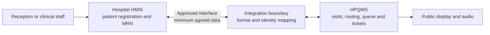

# Proposed HPQMS–HMIS Integration

**Status:** Discussion draft — not an implementation specification  
**Purpose:** Describe a safe, incremental integration to review with a hospital IT team and its HMIS vendor.  
**Scope:** Documentation only. No integration code or schema changes are included.

**Regulatory context:** This draft now records the separate national SHA/DHA integration track. Confirm the current facility obligations, deadlines, and HPQMS classification with the hospital, SHA, and Digital Health Agency (DHA); this document is not legal advice or a compliance determination.

## 1. Summary

HPQMS should complement the hospital’s HMIS. The HMIS should remain authoritative for patient registration and the hospital medical record number (MRN). HPQMS should manage queue visits, routing, tickets, service-point calls, and queue progress. The systems should exchange only the data needed for an agreed workflow.

Integration is technically feasible, subject to the HMIS vendor providing an approved interface and the hospital agreeing on workflow, data ownership, security, and operational responsibilities. HPQMS currently has patient, visit, queue, and live display capabilities, but it does **not** currently include an HMIS adapter. The existing display WebSocket is an internal display transport, not an HMIS integration interface.

There are two integration questions, and they must not be conflated:

1. **Hospital workflow:** how HPQMS exchanges queue and visit data with Guru Narak’s HMIS.
2. **National ecosystem:** how the hospital’s approved HMIS meets SHA and DHA requirements and connects to the national Health Information Exchange (HIE).

The second track is a facility/HMIS obligation and may affect vendor selection, certification, interface design, and deployment. It does not automatically mean HPQMS itself should connect directly to SHA or submit claims. That role and any certification obligation for HPQMS must be confirmed with the hospital, HMIS vendor, SHA, and DHA before implementation.

## 2. Proposed first workflow

Begin with one bounded outpatient check-in workflow:

1. Reception identifies or registers the patient in the HMIS and obtains the hospital MRN and the visit/encounter reference, if available.
2. HPQMS receives the minimum agreed patient and visit details, or looks them up through the HMIS interface.
3. HPQMS creates the queue visit and issues a department ticket.
4. HPQMS manages queue transitions and calls the patient to a service point.
5. HPQMS sends the agreed queue status updates back to the HMIS, if the HMIS supports them and the hospital wants them recorded there.

The initial pilot should use synthetic or otherwise approved test records in a vendor-provided test environment. It should not make production changes until the hospital and vendor have approved the workflow and deployment.

The adapter is a proposed architectural boundary for the HPQMS-to-hospital-HMIS workflow, not a component that exists in the current codebase. It must not be assumed to be an approved middleware component for SHA/DHA exchange: the DHA's published HMIS/HIE guide describes official APIs and direct integration within the HMIS. The hospital's approved design and current DHA guidance take precedence.

## 3. Responsibilities and data ownership

| Information or action | Proposed owner | Notes to confirm |
| --- | --- | --- |
| Patient registration and hospital MRN | HMIS | HPQMS should retain the hospital identifier and its assigning system so the patient can be matched reliably. |
| Queue visit and ticket number | HPQMS | Confirm whether the HMIS needs a reference to the HPQMS visit or ticket. |
| Department and service-point directory | Hospital/HMIS, mapped in HPQMS | Agree stable codes; do not rely on display labels alone. |
| Queue status and call timestamps | HPQMS | Send only if the HMIS has a supported field or event workflow. |
| Clinical notes, diagnoses, orders, billing | HMIS or relevant clinical system | Outside the initial queue integration unless separately agreed. |

Avoid creating a second patient registration in HPQMS when an HMIS record already exists. Matching should use an agreed stable identifier, not patient name alone. Temporary or unidentified-patient workflows need a separate reconciliation rule agreed with the hospital.

## 4. Interface options

Choose the interface only after the HMIS vendor confirms what is supported and approved:

- **Vendor REST API:** use the vendor’s documented endpoints, authentication, and test environment.
- **HL7 FHIR:** use only if the deployed HMIS exposes the required FHIR version, profiles, search behavior, and authorization. FHIR `Patient` and `Encounter` may represent patient and visit context; the vendor must confirm the local implementation guide and workflow.
- **HL7 v2 or an integration engine:** use if this is the hospital’s existing supported route for registration or encounter messages.
- **Other vendor interface:** use a documented, supported interface approved by the hospital. Avoid direct access to the HMIS database unless the vendor explicitly provides and supports that pattern.

For the HPQMS-to-hospital-HMIS link, use the hospital/vendor-approved integration boundary. The public display WebSocket should remain dedicated to display clients. For the separate SHA/DHA exchange, follow the official HIE onboarding and API architecture; do not insert HPQMS or an unapproved third-party middleware into that path.

## 5. Separate SHA/DHA national integration track

Kenya has gazetted the **Digital Health (Data Exchange Component) Regulations, 2025 (Legal Notice No. 77 of 2025)** and the **Digital Health (Health Information Management Procedures) Regulations, 2025 (Legal Notice No. 76 of 2025)**. These establish a national framework for health-data exchange and health-information management. The Digital Health Act also provides for health-data standards, interoperability, security, privacy, and the national integrated health information system. The facility and its HMIS vendor should determine how the requirements apply to their system and workflow.

The DHA's published HMIS/HIE integration guide describes connecting an HMIS to HIE components such as the Client, Facility, and Health Worker registries and Claims. It directs implementers to use official APIs and describes the integration as direct within the HMIS, rather than through third-party middleware. The guide also outlines functions that go beyond queue management, including patient search, eligibility checks, SHA visits, registries, and claims. These are **HMIS/HIE functions**, not features HPQMS currently provides.

The Ministry of Health has also described a transition from the SHA Provider Portal to the SHA HMIS, with secure information exchange involving compliant hospital HMIS platforms. Because transition notices and deadlines can change, the hospital should confirm its current status, the applicable SHA contract requirements, and DHA onboarding steps directly with SHA/DHA. Do not rely on an old deadline or assume a hospital's existing vendor has completed onboarding.

For this project, the practical implications are:

- First ask whether Guru Narak's current HMIS is already DHA-certified/onboarded and connected to the required SHA/DHA services, or whether that work is still in progress with its vendor.
- Treat the SHA/DHA connection as a separate workstream owned by the hospital and its HMIS vendor, unless those parties explicitly ask HPQMS to participate in a defined role.
- Keep HPQMS queue payloads and patient identifiers compatible with the hospital's approved HMIS interface, but do not build an independent SHA client, store DHA credentials/keys, or transmit patient data to HIE without explicit authorization and an agreed technical and governance design.
- Ask whether HPQMS itself falls within a DHA digital-health solution certification category, and what evidence/onboarding is needed before a live hospital deployment.
- Ask the vendor which SHA/DHA/HIE artifacts and API documentation are current and applicable to their deployed version; the public guide is useful orientation, not a substitute for facility-specific onboarding instructions.

## 6. Data exchange to agree

For the first workflow, discuss a minimum field set:

**HMIS to HPQMS:** hospital identifier system and value (MRN), HMIS patient reference, visit/encounter reference, patient name only if needed for staff workflow, visit type, requested department code, and any safe-to-share operational priority indicator.

**HPQMS to HMIS, if supported:** HPQMS visit/ticket reference, department code, queue state, called/service-point state where appropriate, and event timestamps. Public display announcements should contain only the ticket information intended for public viewing; do not expose MRNs or patient demographics on the public display.

The hospital and vendor should approve the exact fields, their meaning, permitted direction, retention, and error behavior before implementation.

## 7. Reliability and identity rules

The eventual design should specify:

- A stable cross-system identifier mapping (identifier **system** plus identifier **value**), including how duplicate or changed identifiers are resolved.
- Duplicate-safe message handling so a retry cannot create a second patient, visit, or queue ticket.
- A correlation/reference ID so an exchange can be traced across HPQMS, the integration boundary, and HMIS.
- Acknowledgement, timeout, retry, and manual-reconciliation behavior. A failed HMIS update must be visible to an operator and must not silently lose a queue event.
- Which system wins if a patient or visit is updated in both systems.
- A documented downtime workflow. Queue operation should not block urgent care if HMIS connectivity is unavailable; any deferred synchronization must be reconciled safely afterward.

## 8. Security, privacy, and governance

Before any live patient data is exchanged, the hospital and vendor should approve the purpose, data fields, legal basis, controller/processor responsibilities, access roles, audit requirements, retention, incident process, hosting/location, and any required agreements or assessments. Use encrypted transport, scoped service credentials, least-privilege access, and audit records that avoid copying unnecessary patient details into logs. Confirm DHA certification and data-exchange onboarding requirements separately; a successful local HMIS integration does not itself demonstrate SHA/DHA compliance.

Kenya’s Digital Health Act provides for standards governing health-data integration, interoperability, and exchange. Confirm the current Digital Health Agency requirements, certification/onboarding steps, and the hospital’s applicable policies with the hospital’s IT team and vendor; this draft does not determine regulatory compliance.

## 9. Decisions required from the hospital and vendor

1. What HMIS product, version, and deployment model are in use?
2. Which supported interface is available (FHIR and version/profile, REST API, HL7 v2, integration engine, or other)? Can they provide documentation and a sandbox?
3. Which patient identifier and encounter identifier should HPQMS use?
4. Does the HMIS create the visit, or does HPQMS? Which system is authoritative for each lifecycle state?
5. Which departments and service points should map to QMS queues?
6. Which queue events, if any, should be written back to the HMIS?
7. What authentication, network, audit, certification, privacy, and vendor-approval requirements apply?
8. Who owns support and reconciliation when either system or the connection is unavailable?
9. What is the facility's current SHA HMIS transition and DHA HIE onboarding status? Who is the named vendor lead?
10. Which current DHA certification, HIE integration, and testing documents apply to the facility and to any HPQMS deployment?

## 10. Suggested implementation stages (after discovery)

1. **Discovery:** obtain interface documentation, agree the workflow, identifiers, ownership, and approved field set.
2. **Contract:** document request/event shapes, authentication, error handling, idempotency, and audit behavior with the vendor.
3. **Sandbox pilot:** implement one workflow using synthetic test records and vendor test credentials.
4. **Acceptance:** jointly verify normal, duplicate, delayed, rejected, and outage cases; confirm queue and clinical operations remain safe.
5. **Controlled rollout:** proceed only after hospital/vendor approval, operational training, monitoring, and a rollback/reconciliation plan.

## 11. Current HPQMS boundary (code review snapshot)

- The codebase has patient and visit models and APIs, queue transitions, and a display event stream.
- The patient model has `national_id` and `temporary_identifier`; it does not currently define a general external identifier system/value mapping for an HMIS MRN.
- Patient-facing API operations currently use the application’s staff authentication/authorization model; a dedicated HMIS service identity has not been established in this draft.
- The queue event sent to the display is not a durable vendor-facing integration contract.
- Therefore, this document describes a proposed integration, not a claim that HPQMS is already HMIS-integrated or certified.
- The SHA/DHA HIE integration guide's HMIS-specific onboarding and direct-integration requirements are not implemented by HPQMS and should not be represented as implemented.

## References

- [HL7 FHIR R4 Patient](https://hl7.org/fhir/R4/patient.html)
- [HL7 FHIR R4 Encounter](https://hl7.org/fhir/R4/encounter.html)
- [Kenya Digital Health Act, 2023](https://www.kenyalaw.org/kl/fileadmin/pdfdownloads/Acts/2023/TheDigitalHealthAct_2023.pdf)
- [Digital Health (Data Exchange Component) Regulations, 2025 — Legal Notice No. 77](https://new.kenyalaw.org/akn/ke/act/ln/2025/77/eng@2025-04-11/source)
- [Digital Health (Health Information Management Procedures) Regulations, 2025 — Legal Notice No. 76](https://new.kenyalaw.org/akn/ke/act/ln/2025/76/eng@2025-04-11/source)
- [DHA AfyaLink: HMIS–HIE Integration Guide](https://afyalink.dha.go.ke/hmis-sha-integration-guide)
- [Ministry of Health: Transition to SHA HMIS](https://www.health.go.ke/index.php/cs-duale-leads-consultative-forum-transition-sha-hmis)
- [Ministry of Health: Digital Health regulations and related materials](https://www.health.go.ke/social-health-regulations)
